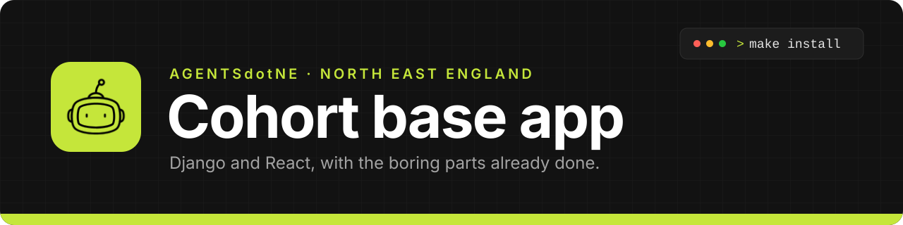

<p align="center">
  <a href="https://agentsdotne.uk"></a>
</p>

<p align="center">
  <a href="https://agentsdotne.uk"></a>
  
  
  
  
  
  
  
</p>

The base application gives your team a working starting point for the six-week project. It already includes
account creation, sign-in, password recovery and account settings. It also provides the navigation around the
application, including a sidebar, mobile menu and user menu. Every screen is built from shadcn/ui components,
so new screens can reuse the same building blocks and look consistent from day one.

The dashboard is deliberately empty. Your team will decide what belongs there after understanding the current
cohort's problem and agreeing a manageable user journey.

## What you get

| | |
| --- | --- |
| Backend | Django 5.2, Django REST Framework, Postgres |
| Frontend | React 19, Vite, TypeScript, Tailwind 4, shadcn/ui |
| Components | shadcn/ui in `src/components/ui`, and Storybook for viewing components on their own |
| Auth | Email and password, session cookies, email confirmation, password reset, change password |
| Uploads | Profile pictures, stored in `backend/media/` in development |
| Email | Templated HTML email, printed to the terminal in development |
| Data | TanStack Query, a typed `apiRequest` wrapper, react-hook-form and zod |
| Checks | ruff, Django tests, ESLint, Prettier and TypeScript, run locally and in GitHub Actions |

## Getting started

Create your team's repository from this one on GitHub (**Use this template**), then clone it.

### The quick way: everything in Docker

With [Docker](https://docs.docker.com/get-docker/) running, one command starts the database, Django and
React together:

```bash
make dev              # or: docker compose up
```

The first start installs every package, so give it a few minutes. Both servers reload when you save a file,
and `Ctrl+C` stops them all.

### Running the servers on your machine

You also need this for `make test` and for your editor's type checking. Install
[uv](https://docs.astral.sh/uv/) and Node 24. With [nvm](https://github.com/nvm-sh/nvm),
`cd frontend && nvm install` picks the right Node from `frontend/.nvmrc`.

```bash
make install          # backend packages with uv, frontend packages with npm
make db               # start only Postgres in Docker, on port 5442
make migrate          # create the tables
```

Then run the two servers, each in its own terminal:

```bash
make backend          # Django on http://127.0.0.1:8000
make frontend         # React on http://localhost:5173
```

### Your first account

Open http://localhost:5173 and create an account. The confirmation email is printed in the **Django
terminal** (the `make dev` output, if you use Docker), not sent, so nothing leaves your machine during
development. Copy the link from there.

Every setting has a working default. To change one, copy `backend/.env.example` to `backend/.env`.

## Everyday commands

```bash
make test             # every check CI runs: ruff, Django tests, ESLint, Prettier, TypeScript
make format           # fix formatting in the backend and the frontend
make superuser        # create an admin account for http://127.0.0.1:8000/admin/
make storybook        # browse components on their own at http://localhost:6006
```

## Where things are

```
backend/
  config/       settings and the top-level URLs
  accounts/     the user model, sign-in endpoints, email sending
frontend/src/
  app/          router, providers, the signed-in shell and its navigation
  auth/         sign in, sign up, confirm email, reset password, useSession
  account/      the account settings dialog: picture, name and password
  components/   shared components, plus ui/ from shadcn
  lib/          apiRequest, useApiForm, the query client, cn
  pages/        standalone pages, like the dashboard
docs/           how things work, and how to add to them
```

## UI components

The building blocks live in `frontend/src/components/ui`: alert, avatar, button, card, dialog, dropdown
menu, input, label, separator, sheet, skeleton and sonner (toasts). They come from
[shadcn/ui](https://ui.shadcn.com), which copies each component's source into the repo instead of installing
a package. That means you own the code: read it, and change it if a design needs it.

- **Check before you build.** If `components/ui` or the [shadcn catalogue](https://ui.shadcn.com/docs/components)
  already has it, use that rather than writing your own.
- **Add one** with `cd frontend && npx shadcn@latest add <name>`. If the new file imports from `"cn"`, see
  [troubleshooting](docs/troubleshooting.md#a-shadcn-component-imports-from-cn).
- **Build on them.** App-level pieces such as `FormField` and `UserAvatar` sit in `src/components` and are
  made from the `ui` ones.
- **See them on their own** with `make storybook`. Add a `*.stories.tsx` file next to a component to give it
  a page; `button.stories.tsx` is the example to copy.
- **Restyle them all at once** by changing the colour variables, as described in [Branding it](#branding-it).

## Guides

- **[A guide for juniors](docs/guide-for-juniors.md).** The whole app explained from scratch: setup, a tour, how it fits together.
- **[Adding a feature](docs/adding-a-feature.md).** Start here. It builds a small to-do list, step by step.
- **[How sign-in works](docs/how-auth-works.md).** Sessions, CSRF, the Vite proxy, and every auth endpoint.
- **[Troubleshooting](docs/troubleshooting.md).** Fixes for the errors people actually hit.
- **[Working on this project](CONTRIBUTING.md).** Branches, pull requests and reviews.
- **[AGENTS.md](AGENTS.md).** The rules AI coding assistants should follow here. `CLAUDE.md` points to it.

## Adding to it

**A feature with data.** Follow [docs/adding-a-feature.md](docs/adding-a-feature.md).

**A page.** Create it in its feature folder (or `src/pages` if it stands alone), add a `<Route>` in
`src/app/router.tsx`, and add a link in `src/app/layout/app-nav.tsx`. The sidebar and the mobile menu both
read that list.

**An email.** Call `send_templated_email(to, subject, template, context)` from
`backend/accounts/emails.py`. Templates live in `backend/accounts/templates/emails/` and extend `base.html`.

## Branding it

The palette is shadcn's `neutral`, set as CSS variables in `frontend/src/index.css`. Change `--primary`
and `--primary-foreground` under both `:root` and `.dark` and the whole app follows. The app name is set
in `frontend/index.html`, `APP_NAME` in `frontend/src/app/app-name.ts`, and `SITE_NAME` in the backend
settings, which email subjects use.

## What is deliberately missing

This is a starting point, not a finished product. Before anything real:

- **Rate limiting.** Sign-in, sign-up and password reset accept unlimited attempts, so the app is open to
  password guessing and to being used to send spam. Add throttling first.
- **Roles and permissions.** Every signed-in user can use everything, and each user only sees their own
  data. Staff can manage users in Django admin at `/admin/`.
- **Production settings.** `SECRET_KEY` has a default and `DEBUG` is on, so the app runs with no setup.
  Set a real key, turn `DEBUG` off, and read `python manage.py check --deploy` before deploying.
- **Storage for uploads.** Profile pictures are saved to `backend/media/` and served by Django only while
  `DEBUG` is on. In production, store them in object storage such as S3 (`django-storages`).
- **A deployment.** The `Dockerfile` builds the frontend and backend into one image that serves both,
  ready for a host such as Railway, but nothing is deployed for you and the production settings above
  still apply.
- **Live updates.** Data is fetched when a page loads. For a live view, poll with TanStack Query's
  `refetchInterval` before reaching for WebSockets.
- **Frontend tests.** The frontend has lint and type checking only. Add Vitest and Testing Library when
  you have behaviour worth pinning down.
- **AI integration.** When you add one, put the API key in `backend/.env` and call the model from
  Django. A key shipped to the browser is a key you have given away.

---

<p align="center">
  Built for the <a href="https://agentsdotne.uk">AGENTSdotNE</a> cohort programme, North East England.
</p>
