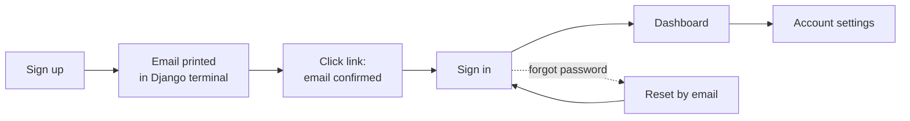
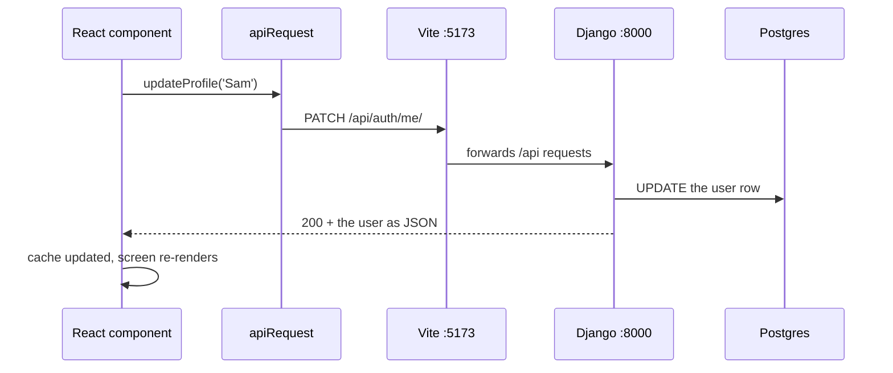
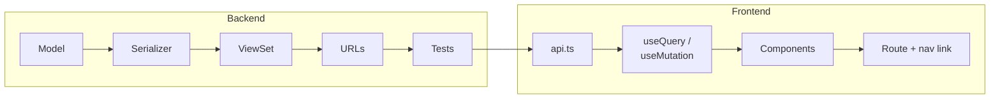
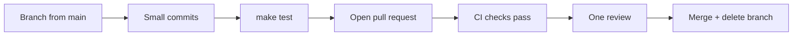

# Cohort base app: a guide for juniors

Sep 24, 2026 · @Kieran Riley

## What this is

The Cohort base app is the starting point for your six-week project: a working web app with accounts already built, so your team can spend its time on your own idea instead of on sign-in and setup.

When you first run it, this already works:

- Sign up, confirm your email, sign in and sign out
- Forgotten password, reset by email link
- Account settings: profile picture, name and password
- An app shell with a sidebar, a mobile menu and a user menu
- Emails, printed in your terminal while you develop
- Automatic checks on every pull request

Everything else is yours to build. The dashboard is deliberately empty, and your project plan says what goes there.

| Part | What it uses |
| --- | --- |
| Backend (the server) | Python, Django, Django REST Framework, Postgres database |
| Frontend (what runs in the browser) | TypeScript, React, Vite, Tailwind CSS, shadcn/ui components |
| Talking between them | JSON over HTTP, fetched with TanStack Query |
| Forms | react-hook-form, with zod for validation |

You don't need to know all of these on day one. You will pick them up as you build, and this guide points you to the right file each time.

## Day one: get it running

You should have the app running on your machine within an hour. If you are stuck for more than 30 minutes, ask.

**Install these first:**

| Tool | What it is for | Get it |
| --- | --- | --- |
| Git | Version control | [git-scm.com](https://git-scm.com/downloads) |
| Docker Desktop | Runs the database, Django and React for you | [docker.com](https://docs.docker.com/get-docker/) |
| An editor | Writing code (VS Code is a good default) | [code.visualstudio.com](https://code.visualstudio.com/) |

On Windows, Docker Desktop runs on WSL. Clone the repository inside WSL, not on the Windows drive, and run every command from a WSL terminal.

**Then, with Docker Desktop running:**

1. Clone your team's repository and move into it.
2. `make dev` starts the database, Django and React together. The first start takes a few minutes.

Open http://localhost:5173 and create an account. No email is really sent in development. Instead, look in the `make dev` output for lines starting `backend-1`: the confirmation email is printed there, with the link to click.

Leave `make dev` running while you work; both servers reload when you save a file. `Ctrl+C` stops everything.

**Accounts without the email step.** With `make dev` running, `make seed` creates three fictional accounts that can sign in straight away: `alex@example.com`, `sam@example.com` and `staff@example.com`, which can also open Django admin. The password is printed when it runs. Two ordinary accounts are what you need to check one user cannot see another's data.

**Before your first pull request**, install two more tools so you can run the checks on your own machine:

| Tool | What it is for | Get it |
| --- | --- | --- |
| uv | Installs Python and the backend's packages | [docs.astral.sh/uv](https://docs.astral.sh/uv/) |
| nvm | Installs the right version of Node.js | [github.com/nvm-sh/nvm](https://github.com/nvm-sh/nvm) |

Then run `cd frontend && nvm install && cd ..` and `make install` once. Your editor uses these packages too, so its type checking starts working.

**Other commands you will use:**

| Command | What it does |
| --- | --- |
| `make test` | Runs every check CI runs: formatting, linting, the migration check, type checking, the backend tests and the frontend build. Run it before you push, with `make dev` running. |
| `make format` | Fixes formatting problems for you. |
| `make migrate` | Applies new migrations. Run it after `makemigrations` while `make dev` is running. |
| `make seed` | Creates the fictional accounts above. |
| `make superuser` | Creates your own admin account for Django admin at http://localhost:8000/admin/. |
| `make storybook` | Shows components on their own at http://localhost:6006, with `make dev` running. |

## A tour of the app

Before reading any code, click through the app as a user would. Knowing what each screen does makes the code much easier to follow.



Signing up sends a confirmation link, and you can't sign in until you have clicked it. Every user journey is in the table below.

| Journey | Where to find it in the app | Frontend code |
| --- | --- | --- |
| Create an account | "Create one" on the sign-in page | `src/auth/sign-up-page.tsx` |
| Confirm your email | The link in the email | `src/auth/verify-email-page.tsx` |
| Get a new confirmation link | "Resend confirmation" on the sign-in page | `src/auth/resend-verification-page.tsx` |
| Sign in | `/sign-in` | `src/auth/sign-in-page.tsx` |
| Forgot your password | "Forgotten your password?" on the sign-in page | `src/auth/forgot-password-page.tsx` |
| Choose a new password | The link in the reset email | `src/auth/reset-password-page.tsx` |
| Change picture, name or password | User menu, top right, then "Account settings" | `src/account/account-dialog.tsx` |
| Sign out | User menu, top right | `src/app/layout/user-menu.tsx` |

Try the app on a narrow window too. Below tablet width the sidebar becomes a menu button in the header.

Staff can also manage every user in Django admin at http://localhost:8000/admin/, after `make superuser` or `make seed`.

## How the code is organised

The repository has two halves: `backend/` is the Django server and `frontend/` is the React app. They are separate programs that talk over HTTP.

**Backend (`backend/`):**

| Folder or file | What lives there |
| --- | --- |
| `config/settings.py` | Every setting: database, email, installed apps. Values can be overridden in `backend/.env`. |
| `config/urls.py` | The top-level URLs. Each app's URLs are included here under `/api/`. |
| `accounts/models.py` | The `User` model. Email is the login; there is no username. |
| `accounts/serializers.py` | Turns users into JSON and checks what the frontend sends. |
| `accounts/views/` | The sign-in, sign-up, password and profile picture endpoints. |
| `accounts/emails.py` + `templates/emails/` | Sending emails, and their HTML templates. |
| `accounts/tests/` | Tests for everything above. |

When you build a feature, you add a new Django app next to `accounts/`, with the same kinds of files.

**Frontend (`frontend/src/`):**

| Folder | What lives there |
| --- | --- |
| `app/` | The router (which URL shows which page), and the signed-in shell: sidebar, header, mobile menu, user menu. |
| `auth/` | The sign-in pages, and `useSession`, which tells any component who is signed in. |
| `account/` | The account settings dialog. |
| `components/` | Shared pieces such as `FormField` and `UserAvatar`. `components/ui/` holds the shadcn components: buttons, cards, dialogs. |
| `lib/` | `apiRequest` (every call to the backend goes through it), `useApiForm`, and small helpers. |
| `pages/` | Pages that don't belong to a feature, like the dashboard. |

A feature gets its own folder here too, named after what it manages.

**Around the code:**

- `docs/` has the guides: adding a feature, how sign-in works, and troubleshooting.
- `Makefile` holds the `make` commands.
- `.github/workflows/ci.yml` runs the checks on every pull request.
- `AGENTS.md` holds the rules for AI coding assistants.

## How a request travels

Every feature you build follows the same path. Here it is for saving your name in Account settings.



1. **The component** (`profile-form.tsx`) calls a small function from its folder's `api.ts`.
2. **`apiRequest`** (`src/lib/api-client.ts`) sends the request. It adds the security token Django needs, and turns any error into an `ApiError` with a readable message.
3. **Vite** forwards anything under `/api/` to Django. The browser only ever sees one address, which is why sign-in cookies just work.
4. **Django** finds the view from the URL, checks you are signed in, validates the data with a serializer, and saves it.
5. **The response** comes back as JSON. TanStack Query stores it, and every component showing that data updates.

Two rules follow from this. Never call `fetch` yourself: always go through `apiRequest`. And never keep a copy of server data in `useState`: read it with `useQuery`, so it stays in step with the server.

## How sign-in works

Sign-in uses a session cookie: after you sign in, the browser holds a cookie that Django recognises, and sends it with every request. You never handle tokens yourself.

- **Signing in.** Django checks the email and password, then sets a cookie called `sessionid`. JavaScript cannot read it, so a malicious script on the page cannot steal it.
- **Knowing who is signed in.** Any component can call `useSession()` to get the current user, or `null` when nobody is signed in. Call it where you need it; don't pass the user down through props.
- **Protected pages.** Pages inside `RequireAuth` in `src/app/router.tsx` send signed-out visitors to the sign-in page.
- **Protected endpoints.** Every Django view requires sign-in by default. A signed-out request gets a **401**, and the app sends you back to sign-in.
- **CSRF protection.** Because the cookie is sent automatically, another website could try to make your browser send a request. Django blocks this by requiring a second token on every change, which `apiRequest` adds for you.
- **Email links.** Confirmation and password reset links carry a signed token that expires after three days and works only once.

**401 or 403?** A 401 means you are not signed in. A 403 means you are signed in but not allowed to do that. Use 403 when you add rules about who can do what.

You won't need to change any of this to build your feature. The full details, and a list of every sign-in endpoint, are in `docs/how-auth-works.md`.

## Building your first feature

Every feature is built the same way, in the same order: the database table, then the API, then the screen. `docs/adding-a-feature.md` walks through a full example with code you can copy.



| Step | File | What it does |
| --- | --- | --- |
| 1. Model | `models.py` | Defines the database table. Run `makemigrations` and `migrate` after every change. |
| 2. Serializer | `serializers.py` | Converts rows to JSON and checks what the frontend sends. |
| 3. ViewSet | `views.py` | The endpoints: list, create, update, delete. |
| 4. URLs | `urls.py` | Gives the endpoints their addresses under `/api/`. |
| 5. Tests | `tests/` | Prove each endpoint works. `make test` runs them. |
| 6. API functions | `api.ts` | One small function per endpoint, all using `apiRequest`. |
| 7. Hooks | `use-*.ts` | `useQuery` to read data, `useMutation` to change it. |
| 8. Components | one per file | The list, the form, the buttons. Handle loading, error and empty states. |
| 9. Route and link | `router.tsx`, `app-nav.tsx` | Makes the page reachable from the sidebar and mobile menu. |

**The one rule you must never skip:** every view's `get_queryset` must return only the rows the signed-in user is allowed to see. It is usually one line:

```python
def get_queryset(self):
    return self.request.user.notes.all()
```

Forget it, and every user can read and change everyone else's data. Reviewers check this line first, and you should write a test that proves another user's data is out of reach.

## How we work together

All work goes through pull requests: nobody pushes straight to `main`. The full rules are in `CONTRIBUTING.md`.



- **Branch names** say what changes, starting with a verb: `add-note-search`, `fix-empty-title`. No names or initials.
- **Keep pieces small.** Work you can finish in a day or two. If it is bigger, split it.
- **Run `make test` before you push.** CI runs the same checks on every pull request, and a pull request with failing checks does not get merged.
- **Fill in the pull request template:** what it does, how you tested it, and a screenshot for anything visual.

**Reviewing is part of the job.** It is how you learn the parts of the code you didn't write.

- Pull the branch and try it. Don't just read the diff.
- Check that every new view only returns the signed-in user's data.
- Ask questions rather than giving orders: "What happens if the title is empty?"
- Approve when it works and you'd be happy to change it next week. It doesn't have to be how you would have written it.

## Using AI assistants

You can use AI coding assistants on this project, but you are responsible for every line you commit. If you can't explain what a piece of code does, don't commit it.

- **The project tells assistants its rules.** `AGENTS.md` lists the patterns to follow, and most assistants read it automatically. Claude Code reads it through `CLAUDE.md`.
- **Ask it to explain, not only to write.** "Why does this view need `get_queryset`?" teaches you more than "write me a view".
- **Check it followed the patterns.** Assistants like to call `fetch` directly, invent new helpers, or skip the loading and error states. Compare its code with the guide.
- **Run `make test` on what it wrote,** and try the change in the browser yourself.
- **Never paste secrets** (API keys, passwords, the contents of `backend/.env`) into a chat.

If your project uses an AI model itself, call it from Django and keep the API key in `backend/.env`. A key in frontend code can be read by anyone who opens the site.

## When you are stuck

Most problems are one of a handful of known ones. Check this table, then `docs/troubleshooting.md`, then ask your team. Being stuck for more than 30 minutes is a signal to ask, not a failure.

| What you see | What it usually means | What to do |
| --- | --- | --- |
| "The app can't load right now" or "The server had a problem" | Django isn't running, or it crashed | Read the last `backend-1` lines in the `make dev` output, or restart `make dev` |
| "Could not reach the server" | Vite isn't running | Check `make dev` is still running, then reload |
| Sent back to the sign-in page | Your session ended | Sign in again |
| `403 CSRF Failed: Origin checking failed` | The frontend is on a different port from the one Django expects | Set `FRONTEND_URL` and `CSRF_TRUSTED_ORIGINS` in `backend/.env` to the address in your browser |
| `relation "..." does not exist` | A migration hasn't been run | `make migrate` (and `makemigrations` first if you changed a model) |
| `crypto.hash is not a function` | Your Node version is too old | `cd frontend && nvm install` |
| Database connection refused | The database isn't running | Start `make dev` |
| `make test` fails on formatting | Code isn't formatted | `make format`, then `make test` again |
| No confirmation email | Emails aren't sent in development | Look for the link in the `backend-1` lines of the `make dev` output |

**Where to look when something breaks:**

1. **The browser console** (F12, then Console). Frontend errors show here.
2. **The Network tab** (F12, then Network). Click the red request to see what Django answered.
3. **The `make dev` output.** Every request is logged on a `backend-1` line, and server errors print a full traceback. The last few lines name the file and line.

When you ask for help, say what you did, what you expected, what happened instead, and paste the exact error.

## What is deliberately left out

The template stops where your project should start. These gaps are known and intentional, and each one makes a good stretch goal once your main feature works.

| Missing | Why it matters | Where to start |
| --- | --- | --- |
| Rate limiting | Anyone can try unlimited passwords, or use the sign-up form to send spam emails | Django REST Framework's `ScopedRateThrottle` on the sign-in, sign-up and password reset views |
| Roles and permissions | Every signed-in user can do everything | A permission class that returns 403, plus tests for who can and can't |
| Frontend tests | Only the backend has tests today | Vitest and React Testing Library |
| Image resizing | Profile pictures are stored at full size | Resize with Pillow when saving, to about 256 pixels |
| Live updates | Screens only change when you reload or act | TanStack Query's `refetchInterval` before anything more complex |
| Deployment | It only runs on your machine | A Dockerfile, production settings, and object storage for uploads |

Before anything goes live, the production settings must change: a real `SECRET_KEY`, `DEBUG` turned off, and `python manage.py check --deploy` passing. Your project won't need to go live in six weeks, but know that the defaults are for development only.

## Glossary

| Term | Meaning |
| --- | --- |
| API | The set of URLs under `/api/` that the frontend calls to read and change data. |
| Endpoint | One URL and method in the API, such as `GET /api/auth/me/`. |
| Model | A Python class that defines a database table (`models.py`). |
| Migration | A file describing a change to the database tables. `makemigrations` writes it; `migrate` applies it. |
| Serializer | Converts model rows to JSON and back, and validates incoming data. |
| ViewSet | A Django REST Framework class that provides list, create, update and delete for one model. |
| `get_queryset` | The method on a view that decides which rows it can see. Limit it to the signed-in user's rows. |
| Session cookie | The cookie that keeps you signed in. The browser sends it with every request. |
| CSRF | Cross-site request forgery: another site tricking your browser into sending a request. Blocked by a token `apiRequest` adds. |
| 401 / 403 | 401: not signed in. 403: signed in, but not allowed. |
| Proxy | Vite forwarding `/api/` and `/media/` requests to Django, so the browser sees a single site. |
| `apiRequest` | The one function the frontend uses to call the API (`src/lib/api-client.ts`). |
| `useQuery` | Reads data from the API and caches it, so components share one request. |
| `useMutation` | Sends a change to the API, then refreshes the data it affected. |
| `useSession` | Returns the signed-in user, or `null`. |
| Query key | The name a cached result is stored under, such as `['session']`. |
| shadcn/ui | The library of ready-made components in `src/components/ui/`, added with `npx shadcn@latest add`. |
| zod | Describes what valid form data looks like, so forms can show errors before sending. |
| CI | Continuous integration: the checks GitHub runs on every pull request. |
