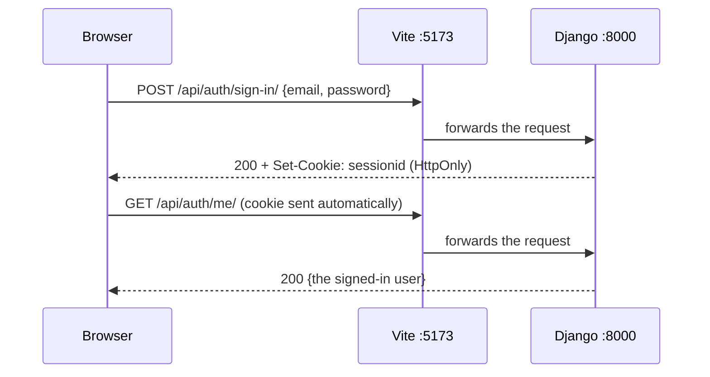

# How sign-in works

You should not need to change any of this to build your feature, but you will debug it at some point,
so it helps to know the moving parts.

## One origin, one cookie

In development the browser only ever talks to Vite on `http://localhost:5173`. Vite forwards anything
under `/api/` to Django on port 8000 (see `server.proxy` in
[vite.config.ts](../frontend/vite.config.ts)).

Because the browser thinks it is one site, Django's session cookie just works. There are no tokens in
`localStorage` and no CORS settings. The cookie is `HttpOnly`, so JavaScript cannot read it, which means a
script injected into the page cannot steal it.

## CSRF

A cookie is sent with every request to the site, including ones another website tricks the browser
into making. CSRF protection stops that: every request that changes something (POST, PATCH, DELETE)
must also carry a token that only our own page can read.

[api-client.ts](../frontend/src/lib/api-client.ts) handles it. Before its first change it calls
`/api/auth/csrf/`, which sets a `csrftoken` cookie, and then copies that cookie into an `X-CSRFToken`
header on every change. Django also checks the request's `Origin` against `CSRF_TRUSTED_ORIGINS`.

If you see `403 CSRF Failed: Origin checking failed`, the frontend is running on a URL that is not in
`CSRF_TRUSTED_ORIGINS`. See [troubleshooting](troubleshooting.md).

## Who is signed in: `useSession`

[use-session.ts](../frontend/src/auth/use-session.ts) asks `/api/auth/me/` who you are, and caches the
answer. It returns the user, or `null` if the server says 401.

- [require-auth.tsx](../frontend/src/auth/require-auth.tsx) wraps every signed-in page. While the
  session is loading it shows a skeleton, and if there is no user it redirects to `/sign-in`.
- Any component that needs the user calls `useSession()` itself. Do not pass the user down as a prop.
- Signing in writes the user into that cache, and signing out sets it to `null`, so the whole app reacts.

## 401 and 403

Django REST Framework normally answers "not signed in" with 403. This project changes that to 401 (see
[authentication.py](../backend/accounts/authentication.py)), so the two mean different things:

- **401**: you are not signed in. The frontend treats you as signed out.
- **403**: you are signed in but not allowed to do this. Use it when you add permissions.

## Email links

Sign-up, "resend confirmation" and "forgot password" all email a link containing a `uid` and a `token`.

- The `uid` is the user's id, encoded for a URL.
- The `token` is signed with `SECRET_KEY` and expires after `PASSWORD_RESET_TIMEOUT` (three days).
- It includes something that changes once the link is used (the password hash, or `email_verified`), so
  every link works exactly once.

The frontend page for the link posts both values back to Django, which checks them in
[serializers.py](../backend/accounts/serializers.py).

## What each endpoint does

| Endpoint | Signed in? | Does |
| --- | --- | --- |
| `GET /api/auth/csrf/` | no | sets the CSRF cookie |
| `POST /api/auth/sign-up/` | no | creates an unconfirmed account and emails a link |
| `POST /api/auth/verify-email/` | no | confirms the email from the link |
| `POST /api/auth/resend-verification/` | no | emails a new confirmation link |
| `POST /api/auth/sign-in/` | no | starts a session (confirmed accounts only) |
| `POST /api/auth/sign-out/` | no | ends the session |
| `POST /api/auth/password-reset/` | no | emails a reset link |
| `POST /api/auth/password-reset/confirm/` | no | sets a new password from the link |
| `GET /api/auth/me/` | yes | returns the signed-in user |
| `PATCH /api/auth/me/` | yes | changes the user's name |
| `PUT /api/auth/me/avatar/` | yes | uploads a profile picture (an image under 2 MB, sent as a file) |
| `DELETE /api/auth/me/avatar/` | yes | removes the profile picture |
| `POST /api/auth/change-password/` | yes | changes the password, and keeps this session signed in |

Endpoints that take an email address answer the same way whether or not the account exists, so they
cannot be used to find out who has signed up.
